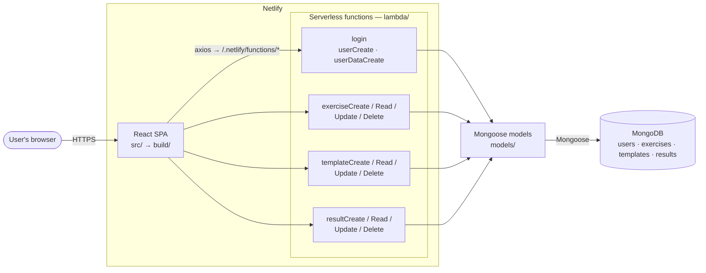
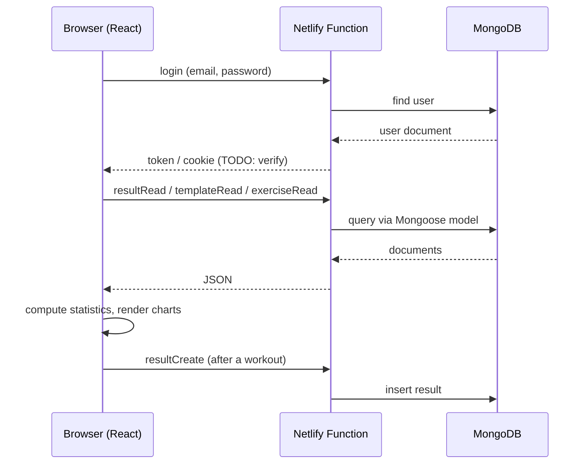
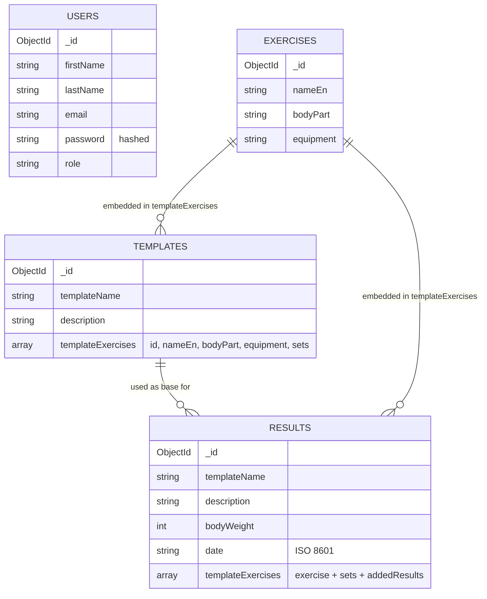

# GymApp (GymGenius)

A workout-logging web app: plan training templates, log sets and body weight, and track progress per exercise with charts and statistics.

**Live demo:** https://gymgenius.netlify.app

## Features

- Authentication (users with roles)
- Exercise catalogue (body part, equipment) with full CRUD
- Training templates (reusable plans, e.g. "HT BT A 2023-03") with full CRUD
- Workout results: sets, weight, repetitions, body weight, date, with full CRUD
- Body weight chart over time
- Weekday distribution diagram and activity calendar
- Per-exercise statistics, charts and history table:
  - RM, RM / body mass
  - Best set volume, best set volume / body mass
  - Best total volume, best total volume / body mass
- CSV export (`react-csv`)

## Tech stack

| Layer | Technology |
|-------|------------|
| Frontend | React 17 (Create React App), React Router 6, Bootstrap / React-Bootstrap / Reactstrap, Sass |
| Charts | Recharts, react-activity-calendar |
| API | Netlify Functions (`lambda/`) — Node.js, one function per operation |
| Database | MongoDB + Mongoose (`models/`) |
| Auth | bcryptjs (password hashing), jsonwebtoken, cookie-parser (TODO: verify flow) |
| Hosting / CI | Netlify (`netlify.toml`) |

## Architecture



### Components

| Path | Responsibility |
|------|----------------|
| `src/` | React application: pages, components, charts, statistics logic |
| `lambda/` | Netlify Functions — the production API (see table below) |
| `models/` | Mongoose schemas: `userModel`, `exerciseModel`, `templateModel`, `resultModel` |
| `server/` | Standalone Express server (`server.js`, `db/conn.js`, `routes/record.js`) with its own `package.json`, plus `insert-data.js` for loading initial data. TODO: verify whether it is a local/legacy backend |
| `db/` | TODO: verify (connection helper / data?) |
| `public/` | Static assets |
| `netlify.toml` | Build command, publish dir (`build`), functions dir (`lambda`) |

### API (Netlify Functions)

Every file in `lambda/` is exposed as `/.netlify/functions/<file-name>`.

| Resource | Functions |
|----------|-----------|
| Auth / users | `login`, `userCreate`, `userDataCreate` (TODO: describe) |
| Exercises | `exerciseCreate`, `exerciseRead`, `exerciseUpdate`, `exerciseDelete` |
| Templates | `templateCreate`, `templateRead`, `templateUpdate`, `templateDelete` |
| Results | `resultCreate`, `resultRead`, `resultUpdate`, `resultDelete` |
| Other | `server` (TODO: describe) |

> TODO: add HTTP method, request body and response for each function.

### Request flow



## Data model

MongoDB collections: `users`, `exercises`, `templates`, `results`.
Templates and results embed a copy of the exercise data (denormalised), so a result keeps its history even if the exercise changes later.



> TODO: verify how `results` / `templates` are linked to `users` (e.g. a user id field) and the exact field names in `userModel`.

### Example documents

**exercises**

```json
{
  "_id": "624992452b437add5cb04f07",
  "nameEn": "front raise",
  "bodyPart": "shoulders",
  "equipment": "BARBELL"
}
```

**templates**

```json
{
  "_id": "63fe0cf021cd2dda4e84ff63",
  "templateName": "HT BT A 2023-03",
  "description": "Hypertrophy bottom A, weeks 1-4",
  "templateExercises": [
    {
      "id": "63c6d6cf636f4623dd38512b",
      "nameEn": "HAMSTRING CURLS",
      "bodyPart": "LEGS",
      "equipment": "MACHINE",
      "sets": 3
    }
  ]
}
```

**results**

```json
{
  "_id": "62e6428505a6b63ba89c2e3c",
  "templateName": "FBW B",
  "description": "Pull 2022",
  "bodyWeight": 89,
  "date": "2022-01-26T09:48:42.000Z",
  "templateExercises": [
    {
      "id": "624992452b437add5cb04f5a",
      "nameEn": "pull up",
      "bodyPart": "back",
      "equipment": "assisted bodyweight",
      "sets": 5,
      "addedResults": [
        { "id": "624992452b437add5cb04f5a-0", "setWeight": 89, "setRepetition": 8 },
        { "id": "624992452b437add5cb04f5a-1", "setWeight": 89, "setRepetition": 7 }
      ]
    }
  ]
}
```

## Statistics

Computed on the client from `results.templateExercises[].addedResults[]`:

| Metric | Description |
|--------|-------------|
| RM | Best one-rep max for the exercise (TODO: state formula, e.g. Epley/Brzycki or best recorded) |
| RM / mass | RM divided by body weight at that session |
| Set volume | `setWeight × setRepetition` — the best single set is reported |
| Total volume (V) | Sum of set volumes in one session |
| V / m | Total volume divided by body weight |

## Getting started

### Prerequisites

- Node.js 16+ (TODO: verify)
- A MongoDB instance (e.g. MongoDB Atlas)
- Netlify CLI (included in dependencies)

### Environment variables

Create a `.env` file (never commit it):

```
MONGODB_URI=...      # TODO: verify variable names
JWT_SECRET=...
```

### Run locally

```bash
npm install
npx netlify dev      # React app + Netlify Functions
# or only the frontend:
npm start
```

### Seed the database

```bash
cd server
npm install
node insert-data.js  # TODO: verify
```

### Build

```bash
npm run build        # output: build/
```

### Deploy

Netlify builds from `netlify.toml`:

```toml
[build]
command = "npm run build"
functions = "lambda"
publish = "build"
```

## Project structure

```
GymApp/
├── db/                  # TODO
├── lambda/              # Netlify Functions (API)
│   ├── exercise{Create,Read,Update,Delete}.js
│   ├── result{Create,Read,Update,Delete}.js
│   ├── template{Create,Read,Update,Delete}.js
│   ├── login.js
│   ├── userCreate.js
│   ├── userDataCreate.js
│   └── server.js
├── models/              # Mongoose schemas
│   ├── exerciseModel.js
│   ├── resultModel.js
│   ├── templateModel.js
│   └── userModel.js
├── public/              # static assets
├── server/              # standalone Express server + data seeding
│   ├── db/conn.js
│   ├── routes/record.js
│   ├── insert-data.js
│   └── server.js
├── src/                 # React app
├── netlify.toml
└── package.json
```


